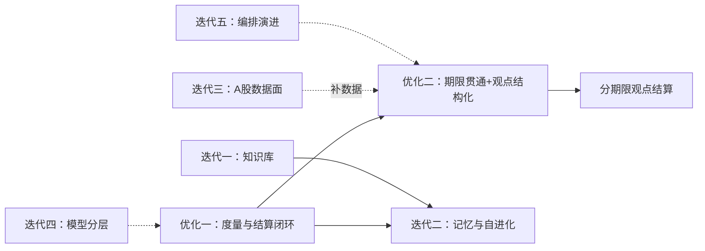

# AI 股票分析优化与迭代方向

> **实施进度速览（2026-10-30 更新）**
>
> | 方向 | 状态 | 已落地内容 |
> |------|------|-----------|
> | 优化一：度量与结算闭环 | ◐ 部分完成 | **决策结算记分卡已上线**：登记/定价（T+1 开盘、一字板判 unfillable、北交所幅差）/第 7 交易日结算/记分卡页（校准曲线、命中率趋势、错题本 tab）/三处状态徽章/历史回填；已用真实 LLM 分析全链路验证（16/17 真报告 → 自动登记 → pending 等定价）。PiT 回放评测、稳健性协议、消融制度**未实施**（依赖回测引擎） |
> | 优化二：期限贯通与观点结构化 | ◐ 方案 A 完成 | **期限贯通（方案 A）已落地**（详见 `docs/投资期限贯通.md`）：horizon（short=7/mid=20/long=60 交易日）进 `AnalysisParameters` 与单股/批量表单；运行时 prompt 锚点（仅 mid/long 注入，short/None 零漂移，seeds 不动）；结算按任务期限阅卷（max_wait_days=max(90,2N+10) 修复长线被 90 天 cap 误杀）；记分卡 by_horizon 分组（pending 只计数不阅卷）+ 持有期筛选；切档联动推荐分析师池（confirm 可保留自选）；golden 基线零重生成通过。方案 B（观点级 horizon 标注）**未实施**（留缝已写入文档） |
> | 迭代一：知识库与语料层 | ◐ 一期完成 | 语料标准化（stock_news 收编 type/summary、hash 并 symbol）、三市场向量索引（本地 bge-m3 免费栈）、检索（symbol+as_of 防前视+类型过滤）、分析师预注入（新闻/情绪分析师首批接线）与引用校验（kb_citation_stats）、embedding 配置化（model_type 字段+配置 UI 向量模型分组）、知识库管理页三 tab。研究循环化、知识图谱**未实施**（按设计排除在本期外） |
> | 迭代二：记忆与自进化 | ✗ 未实施 | reflector 点火与记忆持久化为下一期（P1） |
> | 迭代三：A 股数据面 / 迭代四：模型分层 / 迭代五：编排演进 / 迭代六：权重级学习 | ✗ 未实施 | — |
>
> 当前免费模型栈：OpenRouter 免费 chat + 本地 Ollama bge-m3（1024 维）；知识库索引语料 12 万级。

> **版本**: v1.0
> **日期**: 2026-10-28
> **性质**: 调研与设计讨论稿（未定稿，不含实施决定）
> **来源**: 三路并行调研——学术文献（arXiv / SSRN / 顶会，知网类无权威把关来源按要求排除）、开源工程实践、本项目代码现状走查；关键结论已抽查核实（见附录 A）
> **代码基线**: main 分支 `ce9f45f7`
> **范围**: 分析引擎（`app/engine/`）与分析工作流的优化方向与后续迭代方向；数据层架构不在本文档范围（见《全市场股票数据架构设计文档》）

---

## 总判断

2025-2026 年行业主线已从「多智能体能出决策」转向「决策可审计、按期限结算、有记忆能进化」。本项目的编排层（自研 spec→compile→execute 工作流引擎）处于同类项目第一梯队，真正的差距在四个尚未建立的维度：

1. **期限维度**——短线/长线不是系统参数，两类论据混流（优化方向二）
2. **度量与结算闭环**——prompt / 模型 / 工作流的任何改动目前无法验证效果（优化方向一）
3. **知识库与记忆**——全仓零命中，reflector 与交易记忆未成进化闭环（迭代一、二）
4. **A 股短线数据面**——涨停/连板等核心数据无落点（迭代三）

优化方向一、二解决「准不准、乱不乱」，迭代方向解决「越来越聪明」。

---

## 一、现状诊断（为什么要动）

以下事实来自代码走查，关键引用已抽查核实，可直接复核。

### 1.1 投资期限只存在于 prompt 文案，不是系统参数

- trader 的执行要求写死为「未来 3 天买入价格区间 / 未来 7 天卖出价格区间」（`config/defaults/phase2_agents_config.yaml:411`、`:421`），「持有周期：短线 ≤ 7 个交易日，中线 ≤ 30 个交易日」（`:445`）
- bull/bear 辩论被要求提供「未来 7 天协同性证据」（`:96`、`:232`）
- 而 `AnalysisParameters`（`app/models/analysis.py:35-74`）从市场、日期、分析师、模型到工作流参数一应俱全，**唯独没有期限字段**；任务 state（`app/engine/orchestrator/state.py:334-346`）与前端表单同样没有
- 风控阈值与期限无关且写死在 trader prompt 里（融资余额/流通市值 > 8% 降仓、单笔亏损 ≤ 3%，`:432-433`、`:446`）

### 1.2 论据整体注入，无期限分桶

默认工作流 default-4stage 中，六份分析师报告（含短线资金报告与基本面报告）被**整体注入**每个下游阶段：research_debate（`config/seeds/workflows.json:164-173`）、trader（`:181-191`）、risk_debate（`:207-220`）、summary（`:228-239`）。执行层在 `app/engine/orchestrator/workflow/executor.py:503` 快照后由各 agent 工厂原样拼进 prompt，无字段级筛选。

结果：基本面估值论据被迫在 7 天窗口内与资金流论据对打。这是「短线长线混乱」的技术根源。

### 1.3 默认配置即短线

默认勾选的分析师全部为短线系，基本面分析师默认不选（`tests/routers/test_agent_configs.py:101-108` 有断言固化）。全系统唯一显式的期限体系在选股模块（`config/screening/strategies.yaml:7-21` 的 short_term / balanced / value 三风格），但未与分析流水线打通。

### 1.4 能力空白

- 涨停/连板数据全仓无落点（`app/data` 无对应数据域，工具层无工具，最接近的只有龙虎榜）
- 「知识库」在 docs 与 app 全仓零命中
- 交易记忆硬编码 5 槽（bull/bear/invest_judge/trader/risk_manager，`app/engine/orchestrator/workflow/spec.py:60`，ChromaDB 实现 `app/engine/agents/utils/memory.py`）

### 1.5 有利条件

工作流引擎三类 stage（parallel_batch / debate / single，`spec.py:167-182`）、槽位输入契约（`:63-79`）与编译期 fail-fast 的表达力，足以承载期限分离与结构化改造，无需推翻重写。

---

## 二、优化方向一：度量与结算闭环（最高优先级）<!-- 状态：◐ 部分完成 2026-10-29——决策结算记分卡已上线并经真实 E2E 验证（见文首速览）；PiT 回放/稳健性/消融待回测引擎 -->

**论点：没有度量，一切优化都是玄学。这是所有后续迭代的前置条件。**

### 2.1 理论依据

- **前视偏差是最大威胁**。Look-Ahead-Bench（arXiv 2601.13770，2026-01，已核实）证明主流 LLM 在 point-in-time 设定下普遍获得虚高收益——模型是在「回忆」训练语料里的未来信息，而不是「预测」。任何历史回放评测若不严格控制输入数据的时点可见性，结论无效
- **结论对采样敏感**。TradingAgents 复现性研究（ACM 2026，DOI 10.1145/3800973.3801029，未逐条核验）发现同类框架的结论在温度/种子扰动下显著波动
- **多智能体不是免费午餐**。arXiv 2505.21298 系统性指出多智能体金融框架常未真正超过「单代理 + 好提示词」；辩论轮数、agent 数量的增益需要消融验证而非默认相信
- **情绪信号确有预测力**。「Can ChatGPT Forecast Stock Price Movements?」的 Journal of Financial Economics 2026 正式版（金融学 Top3 期刊）确认新闻情绪对次日收益有显著样本外预测力——方向是对的，问题全在度量纪律
- **LLM 金融局限性**。arXiv 2504.00042 指出 LLM 在历史金融表现与时序知识上的系统性短板，评测设计必须覆盖这些失效面

### 2.2 设计要点

1. **决策结算记分卡**：每次分析决策落库后，按其自身期限在其后首个可交易日触发结算；A 股口径必须考虑 T+1 与涨跌停约束（一字板买不进也卖不出，按无法成交处理而非按收盘价计）。分期限统计方向命中率、收益分布、置信度校准曲线（声称为 70% 把握的判断是否真有 70% 命中）
2. **PiT 回放评测**：历史重放只喂「决策时点可见」的数据——由数据层按 as-of 日期取截面快照构造 prompt，财报用披露日口径，杜绝未来信息进入输入
3. **稳健性协议**：固定采样参数（temperature / seed），重要对比实验做多 seed 报告（均值 ± 波动）
4. **消融制度**：单代理 vs 多代理、辩论轮数、分析师数量，作为定期运行的固定消融项

### 2.3 验收标准

- 任一 prompt / 模型 / 工作流改动，能给出前后对比的记分卡数字
- 历史回放的每个输入字段可追溯到 as-of 时点（可审计）
- 多 seed 下结论方向稳定

---

## 三、优化方向二：期限贯通与观点结构化

### 3.1 目标

让「短线」「长线」从 prompt 文案升级为贯穿参数、工作流、辩论、结算的一等维度；让每条论据显式声明自己在哪个时间尺度上有效。

### 3.2 方案比较

| 方案 | 做法 | 评价 |
|------|------|------|
| **A. 期限参数贯通** | horizon（short/mid/long）进 `AnalysisParameters` 与前端表单；按期限出工作流变体——分析师池、辩论窗口、trader 持有期、风控阈值整套联动 | 工作量中等（数周量级）；seeds 参数化天然支持；立刻让用户能选「长线分析」 |
| **B. 观点级期限标注** | 每条论点结构化输出自带 horizon，trader 按期限分桶聚合，结算按各自期限评分（短线 5 日、基本面 63/252 交易日，未到期记 pending） | 目标架构；治本——不是禁止长短混，而是让每条论据声明自身有效时间尺度 |
| **C. 双轨完全分离** | 短线/长线两条独立工作流，仅在组合层汇总 | 最省心但重复建设，且丢失「长线投资者也看短线买点」的真实研究形态 |

**推荐：A 打底、B 为目标架构。** 两者不冲突——B 的结构化 schema 本就该包含 horizon 字段，A 是 B 的降级可用版。期限分类法直接对齐选股模块的 short_term / balanced / value 三风格，产品语言统一。

### 3.3 观点结构化 schema（方向二的核心产物）

每个分析师/辩论方的输出从散文改为结构化观点列表，每条观点至少包含：

| 字段 | 含义 | 用途 |
|------|------|------|
| `direction` | 多/空/中性 | 可聚合 |
| `horizon` | 该论点的有效期限（5d / 20d / 63d / 252d） | 分桶与分期结算 |
| `confidence` | 置信度 0-1 | 校准度统计 |
| `key_drivers` | 2-3 个关键驱动 | 辩论逐字段对账、复盘归因 |
| `invalidation_conditions` | 证伪条件 | 长线止损依据、结算判定 |
| `evidence_citations` | 证据引用（数据域 + 时点） | 幻觉控制、可审计 |

一份 schema 同时解决三处需求：辩论从「比文采」变成逐字段对账；trader 拿到可按期限分桶聚合的信号而非文本；历史观点天然可回测、可校准（与优化方向一的记分卡对接）。

### 3.4 配套改造

- **风控期限化**：短线维持阈值止损（单笔亏损 ≤ 3% 等写死值应移入按期限配置）；长线的止损依据从「价格百分比」换成「论点失效条件」（由 `invalidation_conditions` 供给）——3% 的价格噪声对长线毫无意义
- **辩论窗口期限化**：bull/bear 的「未来 7 天协同性证据」要求按 horizon 换挡
- **数据面配套**：长线深度依赖财报质量、估值带、产业趋势；短线还缺涨停/连板数据（见迭代三）。期限分离同时为数据建设排定了优先级
- **结算联动**：观点按自身 horizon 结算（5/20/63/252 交易日），未到期记 pending 不计分——这是 ai-hedge-fund v2.6.2 已验证的做法（其 Buffett/Graham 等长线人格按 252 天结算、事件驱动按 60 天结算）

### 3.5 学术支撑

- arXiv 2505.07078：对 FinMem/FinAgent 类框架的更长周期、更宽股票池重测发现，优势随持有期拉长而衰减、牛熊市行为漂移（牛市过度保守、熊市过度激进）——支持「市场状态识别与信号生成分离」的分层设计
- AEA 2026 会议论文（What Does ChatGPT Make of Historical Stock Returns?）：LLM 对长期平均收益的预测由长期预期而非短期波动驱动——长短线的 prompt 锚点本来就该不同

---

## 四、迭代方向（后续开发）

依赖关系总览：

### 迭代一：知识库与语料层（「AI 更聪明」的地基）<!-- 状态：◐ 一期完成 2026-10-29——语料标准化+向量索引+检索注入+引用校验+embedding 配置化已上线（见文首速览）；研究循环/图谱未实施 -->

- **目标**：公告 / 年报 / 研报 / 新闻语料标准化入库（复用数据层四层架构与 Provider/Adapter 模式），提供检索工具，分析师从「固定工具清单」升级为「检索 → 验证 → 综合」的研究循环，输出强制带引用
- **理论依据**：FinanceHarness（arXiv 2607.27853，2026-07，已核实；TradingAgents 一作的后续工作）给出金融深度研究的分层 harness 设计与 FinanceGym 评测基准——最强模型在其 rubric 下也拿不到 45 分，说明「研究循环 + 专用工具层」还有巨大提升空间。AlphaFin（LREC-COLING 2024）验证检索增强 + 思维链两段式的有效性
- **进阶形态**：时序知识图谱（EACL 2026 的 CTKG：财报/电话会实体带时间戳，天然防前视）；A 股产业链图谱（arXiv 2601.11528：公司-行业-指标-财报边的构建方法）——「上游涨价谁受伤」这类事件传导问题，向量检索答不了，图谱多跳推理才行
- **依赖**：数据层新增语料域；检索工具入工具注册表

### 迭代二：记忆与自进化（从「错题本」到提示词进化）

- **目标**：reflector 从任务内反思升级为跨任务持久记忆：历史判断与后续走势自动对齐生成错题本；同一标的再次分析时注入「上次错在哪、错在哪条逻辑」
- **理论依据**：EvolveTrade（arXiv 2609.17632，2026-09，已核实）把 system prompt 视为「文本参数化策略」，由 Policy Agent 按决策 trace + 已实现盈亏定期修订，多数市场状态下提升夏普与累计收益——进化的是程序性知识（怎么查证据、怎么验证），不是结论记忆。Self-Evolving Agents 综述（arXiv 2507.21046）给出反思/经验记忆/策略更新的分类学
- **工程先例**：跨运行 memory log（按「分析师集 + 辩论轮数 + 资产类型」签名隔离防脏续跑）、影子账户（实盘交割单反推交易规则）、RD-Agent 的「假设 → 实验 → 经验库」环（与因子批算引擎直接互补，NeurIPS 2025）
- **前置条件**：优化方向一的结算数据（没有对错判定就没有学习信号）+ 提示词版本化（配置已迁 DB，具备版本化条件）
- **边界提醒**：市场回报噪声大、非平稳，学习信号信噪比低；先有 PiT 纪律再谈学习，否则会把前视偏差学进去

### 迭代三：A 股数据面补全（短线线的数据地基）

- **目标**：补齐涨停/连板梯队（当前全仓空白）、题材/情绪周期、解禁、政策事件数据域；接入一律走 Provider/Adapter 标准入库，消费方零改动
- **依据**：A 股短线生态的分析维度高度本土化——游资/龙虎榜（已有）、连板高度与炸板率、题材轮动、政策事件冲击。同类 A 股深改项目已把政策分析师、游资追踪、解禁监控做成独立 analyst，可直接对照设计（工程先例见第七节）
- **依赖**：数据层增量；工具注册表扩展

### 迭代四：模型分层与多模型协作

- **目标**：快/深模型分层——提取类、批算审计、L0 研判走便宜快模型；辩论/风控/trader 只用强模型。多模型 ensemble 的分歧度作为不确定性信号输出
- **理论依据**：Fin-R1（arXiv 2503.10453）证明 7B 级金融推理微调模型可承载结构化推理（两阶段 SFT + 规则 RL）；Fin-o1（SSRN 6037726）提醒 7B 长文档是短板，研报/年报解析不能全押小模型。多模型每日信号基准（SSRN 6515058）显示多模型交叉验证是低成本的质量信号
- **依赖**：与优化方向一的记分卡配合（模型分层的效果需要度量验证）

### 迭代五：工作流与编排演进

- **目标**：记忆槽泛化（spec P4 已规划，现为 5 槽硬编码）；analyst 研究循环化（配合迭代一）；事件驱动增量分析——公告/新闻流触发定向重析并推送（freshness 巡检与新闻链路已就位，缺触发器层）
- **判断**：学术警示明确——辩论的增益正被消融研究重新校准（2505.21298、复现性研究），**下一步增益不在加 agent 数，而在观点结构化 + 分期结算 + 记忆泛化**。上游 v0.7 值得吸收的具体点：跨运行 memory log 签名隔离、决策网格回测、五档评级输出

### 迭代六（远期）：权重级学习与组合层

- **权重级学习**（微调 / RL）：技术可行（Fin-R1、Alpha-R1 arXiv 2512.23515），但需要海量干净结算数据且极易过拟合市场状态——把迭代一、二的数据沉淀攒够再考虑
- **组合层**：从单票决策走向多票组合——自上而下行业配置（arXiv 2503.09647）、agentic 因子投资框架（arXiv q-fin 2026-03）、持仓作为分析输入、组合构建与风险限额

---

## 五、理论基础与文献精选

「已核实」= 本轮调研中由主流程打开 arXiv 页面 / 本机 API 逐一确认过；其余条目来自子代理文献扫描（其自称逐条检索核实，主流程抽样未发现幻觉）。

### 综述与基础

- Large Language Models in Finance: A Survey — arXiv 2311.10723（约 807 引，领域奠基综述）
- Where LLMs Fall Short on Financial Tasks — arXiv 2504.00042（LLM 金融局限性：历史表现与时序知识）

### 多智能体与辩论

- TradingAgents — arXiv 2412.20138（本项目学术原型，约 350 引）
- FinanceHarness: Autonomous Financial Deep Research — arXiv 2607.27853（已核实；TradingAgents 一作后续）
- LLMs Miss the Multi-Agent Mark — arXiv 2505.21298（多智能体收益存疑警示）
- On the Reproducibility of the TradingAgents Framework — ACM 2026（采样敏感性警示；DOI 未逐条核验）
- InvestorBench — ACL 2025 / arXiv 2412.18174（代理金融决策外部基准）
- DeepFund — NeurIPS 2025 / arXiv 2505.11065（统一环境实时评估）

### 期限与收益结构

- Can LLM-based Financial Investing Strategies Outperform the Market? — arXiv 2505.07078（优势随期限衰减、牛熊漂移）
- What Does ChatGPT Make of Historical Stock Returns? — AEA 2026（长期预期驱动长期预测）

### 评测与前视偏差

- Look-Ahead-Bench — arXiv 2601.13770（已核实；PiT 前视偏差标准化基准）
- StockBench — OpenReview 2025（防污染直接盈亏口径）
- FinTradeBench — arXiv 2603.19225（news reflection 动作模拟评测）

### 记忆与自进化

- EvolveTrade — arXiv 2609.17632（已核实；提示词即策略的经验进化）
- A Survey of Self-Evolving Agents — arXiv 2507.21046
- AlphaAgent — KDD 2025 / arXiv 2502.16789（正则化探索对抗 alpha 衰减）

### 知识图谱与检索

- Knowledge Graph Construction for Stock Markets with LLM — arXiv 2601.11528
- Context-Enriched Agentic RAG（时序知识图谱 CTKG）— EACL 2026
- AlphaFin — LREC-COLING 2024 / arXiv 2403.12582（检索增强 + CoT 基准）

### 情绪与预测

- Can ChatGPT Forecast Stock Price Movements? — Journal of Financial Economics 2026 正式版（金融学 Top3；新闻情绪样本外预测力）
- Impact of LLMs News Sentiment Analysis on Stock Price Movement Prediction — arXiv 2602.00086（2026）
- Comparing LLMs for Sentiment Analysis in Financial Markets — arXiv 2510.15929

### 微调模型

- Fin-R1 — arXiv 2503.10453（金融推理微调，SFT + GRPO）
- Alpha-R1 — arXiv 2512.23515（RL 驱动 alpha 筛选推理）
- Fin-o1 — SSRN 6037726（长文档短板警示）

### 持续跟踪资源

- arXiv q-fin 月度列表（2026-03 单月 305 篇，agentic 与因子投资为高频主题）
- FAME AI & Finance Paper Hub（fame-ai.org/hub）

---

## 六、风险与边界

1. **前视偏差**：评测与学习两处都必须以 PiT 纪律为前提；知识库若不控制语料时点，会把未来信息固化进检索结果
2. **市场非平稳**：「记住某票会涨」式的结论记忆信噪比极低且危险，自进化只做程序性知识（怎么查证据、怎么验证）
3. **提示注入**：新闻/公告/研报是外部文本，一律作为数据处理，不携带指令权威；分析链路中已有 system-reminder 机制可承接
4. **幻觉控制**：观点 schema 的引用字段 + 「无出处不上结论」是硬约束
5. **合规**：分析输出面向用户时保持「研究参考，非投资建议」的定位

---

## 七、参考工程先例（简表，不再展开）

| 项目 | 一句话借鉴点 |
|------|-------------|
| virattt/ai-hedge-fund（64.3k 星，v2.6.2） | 每个观点声明自身期限并按此结算（252/126/60 天分档，未到期 pending）——优化方向二的直接参照，release 原文已核实 |
| TauricResearch/TradingAgents（117.7k 星，v0.7.1） | point-in-time 数据重整、跨运行 memory log 签名隔离、快/深模型分层、决策按其后首收盘价结算 |
| HKUDS/Vibe-Trading（37k 星/7 个月） | 单 agent + 60 工具 + SKILL.md 技能库（与本项目 Skill 架构同构）、影子账户反哺规则、因子基准台 |
| microsoft/RD-Agent（NeurIPS 2025） | 假设 → 写码 → 回测 → 经验库的自动量化 R&D 环，与因子批算引擎互补 |
| simonlin1212/TradingAgents-astock + a-stock-data | A 股本土化 analyst 维度（政策/游资/解禁）与 A 股补充数据源候选 |

---

## 附录 A：调研方法与可信度说明

- **三路并行调研**：学术文献扫描（子代理，arXiv API + 定向检索，知网类排除）、GitHub 工程扫描（子代理，本机 `gh api` 实测活跃度 + 仓库阅读）、本项目代码现状走查（只读子代理，全部结论带文件:行号）
- **主流程亲自核实**：Look-Ahead-Bench / EvolveTrade / FinanceHarness 三篇 arXiv 页面；TradingAgents / ai-hedge-fund / Vibe-Trading 三仓库活跃度与 ai-hedge-fund v2.6.2 release 原文；本文件 1.1-1.3 节引用的 yaml 与模型代码
- **未逐条核验**：其余论文条目与 ACM DOI（采信子代理报告）；GitHub star 数为 2026-10-28 快照
- **本文档不构成实施决定**；各方向的落地设计（数据 schema、工作流 spec 变更、接口契约）需另行出设计文档并按项目流程评审
